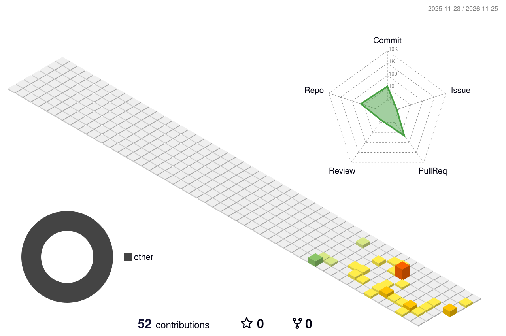

### Building useful things with code, curiosity, and a little bit of AI.

📍 India &nbsp;·&nbsp; 🎓 B.Tech Computer Science, AI & Machine Learning &nbsp;·&nbsp; 🤝 Open to collaborations

---

## About

I'm a computer science student focused on **AI/ML and full-stack development**. I enjoy learning by building: designing interfaces, connecting APIs and databases, and turning ideas into working applications.

- 🌱 Currently growing my skills in React, Node.js, databases, and applied AI
- 🧩 Interested in practical web products and developer tools
- 🚀 Always learning, building, and looking for good problems to solve

## Tech I work with

## Selected projects

| Project | What it explores | Stack |
| --- | --- | --- |
| [Backend-Web-Development](https://github.com/yogeshwaryogesh143-creator/Backend-Web-Development) | A book management REST API with CRUD endpoints | Express · MongoDB · Mongoose |
| [bookmarkbox-api](https://github.com/yogeshwaryogesh143-creator/bookmarkbox-api) | Authentication and personal bookmark API | Express · PostgreSQL · Prisma |
| [streamly-api](https://github.com/yogeshwaryogesh143-creator/streamly-api) | A streaming API learning project for channels and videos | Express · MongoDB · Mongoose |

## My GitHub, in 3D

*My contribution calendar as a 3D landscape · refreshed automatically*

## GitHub stats

---

### Let's build something useful.

<a href="https://github.com/yogeshwaryogesh143-creator">Explore my repositories</a> &nbsp;·&nbsp;
<a href="https://www.linkedin.com/in/yogeshwar-yogesh-0a8018379/">Connect on LinkedIn</a>

Thanks for stopping by — keep learning, keep building. ✨

